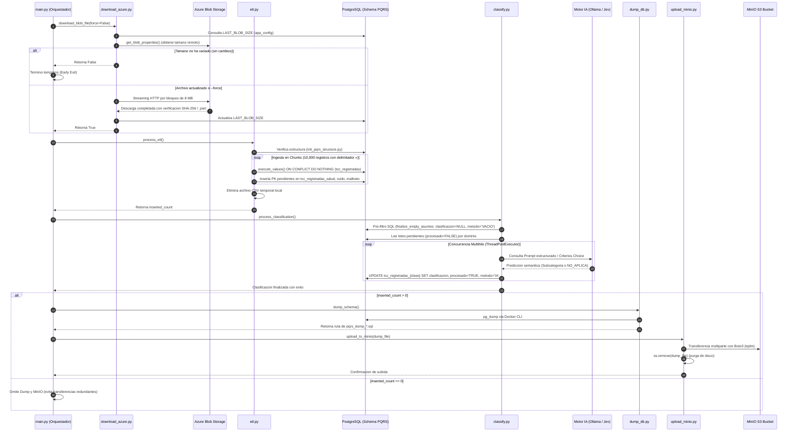

# Arquitectura Técnica y Funcionamiento de Componentes (`vd_procesamiento`)

Este documento consolida la arquitectura del sistema `vd_procesamiento`, detallando la interacción coordinada entre el orquestador principal, los servicios de almacenamiento en la nube, el motor relacional de base de datos, el pipeline de ETL, la arquitectura dual de Inteligencia Artificial y la suite de herramientas analíticas.

---

## 1. Diagrama de Arquitectura y Relación entre Componentes

```mermaid
flowchart TD
    %% ==========================================
    %% CAPA DE CONFIGURACION Y ENTORNO
    %% ==========================================
    subgraph ConfigLayer ["1. Configuracion Desacoplada (12-Factor App)"]
        ENV[".env<br/>(Secretos, Credenciales y URLs)"]
        CFG["config.py<br/>(Modulo Centralizador de Parametros)"]
        ENV --> CFG
    end

    %% ==========================================
    %% CAPA DE ORQUESTACION
    %% ==========================================
    subgraph Orchestration ["2. Orquestador del Pipeline"]
        MAIN["main.py<br/>(Controlador Secuencial e Idempotente)"]
        CFG -.->|Inyecta variables| MAIN
    end

    %% ==========================================
    %% FASE 1: INGESTA REMOTA
    %% ==========================================
    subgraph Phase1 ["3. Ingesta Nube y Sincronizacion"]
        AZ_SRC[("Azure Blob Storage<br/>(TCC_Registradas > 4 GB)")]
        DL["download_azure.py<br/>(Descarga Chunks 8MB + Resume .part)"]
        
        MAIN -->|Paso 1: Ejecuta| DL
        AZ_SRC <-->|Streaming cifrado TLS / Auth Azure| DL
    end

    %% ==========================================
    %% FASE 2: ETL Y MODELADO RELACIONAL
    %% ==========================================
    subgraph Phase2 ["4. Ingesta, Limpieza y Transformacion (ETL)"]
        CSV_TMP["Archivo Local CSV<br/>(Delimitador »)"]
        ETL["etl.py & init_pqrs_structure.py<br/>(Streaming Chunking + execute_values)"]
        
        DL -->|Escribe a disco| CSV_TMP
        MAIN -->|Paso 2: Dispara ETL| ETL
        CSV_TMP -->|Lectura por lotes 10k| ETL
        ETL -.->|Purga temporal al finalizar| CSV_TMP
    end

    %% ==========================================
    %% CAPA DE ALMACENAMIENTO RELACIONAL (POSTGRESQL)
    %% ==========================================
    subgraph DBCluster ["5. Base de Datos Relacional (PostgreSQL en Docker)"]
        subgraph DBSchema ["Esquema: PQRS"]
            T_CONF[("app_config<br/>(LAST_BLOB_SIZE, BATCH_SIZE, etc.)")]
            T_RULES[("config_clasificacion<br/>(Taxonomias y Criterios por Clase)")]
            T_MAIN[("tcc_registradas<br/>(Tabla Maestra: >3.88M filas)")]
            
            subgraph AnalyticsDomains ["Dominios Analiticos Segregados"]
                T_SALUD[("tcc_registradas_salud<br/>(Salud Publica)")]
                T_RUIDO[("tcc_registradas_ruido<br/>(Convivencia y Ruido)")]
                T_ANIMAL[("tcc_registradas_maltrato_animal<br/>(Maltrato Animal)")]
            end
        end

        DL <-->|Valida y actualiza LAST_BLOB_SIZE| T_CONF
        CFG <-->|Carga configuracion dinamica| T_CONF
        ETL -->|Inserta datos maestros ON CONFLICT DO NOTHING| T_MAIN
        ETL -->|Inicializa claves primarias pendientes| AnalyticsDomains
    end

    %% ==========================================
    %% FASE 3: MOTOR DUAL DE INTELIGENCIA ARTIFICIAL
    %% ==========================================
    subgraph Phase3 ["6. Motor Dual de Inferencia IA (classify.py)"]
        CLASSIFY["classify.py<br/>(ThreadPoolExecutor Paralelo por Clase)"]
        SQL_FILTER["Filtro SQL de Asuntos Vacios<br/>(metodo_clasificacion = 'VACIO')"]
        ROUTER{"CLASSIFIER_ENGINE<br/>(Selector en .env)"}
        
        MAIN -->|Paso 3: Dispara Clasificacion| CLASSIFY
        T_RULES -.->|Taxonomias y prompts| CLASSIFY
        AnalyticsDomains & T_MAIN <-->|Pre-filtro directo en BD| SQL_FILTER
        SQL_FILTER -->|Peticiones con Asunto Valido| ROUTER
        
        subgraph EngineOllama ["Inferencia Local"]
            OLLAMA["Ollama Server Local<br/>(GPU/Metal - qwen3:32b)"]
        end
        
        subgraph EngineJev ["Inferencia Cloud Tipada"]
            JEV["TypeSafe System One (Jev)<br/>(API Cloud - Choice Questions)"]
        end
        
        ROUTER -->|OLLAMA| OLLAMA
        ROUTER -->|JEV| JEV
        
        OLLAMA -->|Persistencia streaming con metodo 'IA'| AnalyticsDomains
        JEV -->|Persistencia streaming con metodo 'JEV'| AnalyticsDomains
    end

    %% ==========================================
    %% FASES 4 Y 5: RESPALDO Y PERSISTENCIA REMOTA
    %% ==========================================
    subgraph Phase45 ["7. Respaldo y Persistencia Remota"]
        COND{"¿Hubo nuevos registros?<br/>(inserted_count > 0)"}
        DUMP["dump_db.py<br/>(pg_dump via Docker CLI)"]
        SQL_FILE["pqrs_dump_*.sql<br/>(Snapshot Local)"]
        MINIO_SCRIPT["upload_minio.py<br/>(Cliente Boto3 S3 + tqdm)"]
        MINIO_BUCKET[("MinIO Object Storage<br/>(S3 Bucket Corporativo)")]
        
        MAIN -->|Evaluacion de inserciones| COND
        COND -->|No| SKIP["Omitir Backup<br/>(Evita transferencias redundantes)"]
        COND -->|Si| DUMP
        DUMP -->|Genera instantanea| SQL_FILE
        MAIN -->|Paso 5: Subida| MINIO_SCRIPT
        SQL_FILE --> MINIO_SCRIPT
        MINIO_SCRIPT -->|Upload seguro S3| MINIO_BUCKET
        MINIO_SCRIPT -.->|os.remove tras exito| SQL_FILE
    end

    %% ==========================================
    %% HERRAMIENTAS Y ANALITICA
    %% ==========================================
    subgraph ToolsSuite ["8. Suite Tactica de Auditoria y Reportes (tools/)"]
        TOOL_METRICS["obtener_metricas_pqrs.py<br/>(Genera reporte_metricas_pqrs.md)"]
        TOOL_SALUD["reporte_porcentajes_salud.py<br/>(Genera reporte_porcentajes_salud.md)"]
        TOOL_ANIMAL["export_maltrato_animal_mensual.py<br/>(Genera CSV mensual)"]
        TOOL_MIGRATE["init_maltrato_animal.py<br/>(Migracion DDL e indices parciales)"]
        
        AnalyticsDomains -.->|Consultas analiticas y auditoria| ToolsSuite
    end
```

---

## 2. Diagrama de Secuencia y Ciclo de Vida de los Datos



---

## 3. Matriz Funcional de Componentes

| Componente | Rol en el Sistema | Interaccion con otros Componentes |
| :--- | :--- | :--- |
| [`main.py`](file:///Users/macbookpro/Documents/vd_procesamiento/main.py) | **Orquestador Global:** Conduce el ciclo de vida del pipeline, gestiona parametros CLI (`--force`), evalua terminaciones tempranas y administra errores criticos. | Invoca a [`download_azure.py`](file:///Users/macbookpro/Documents/vd_procesamiento/download_azure.py), [`etl.py`](file:///Users/macbookpro/Documents/vd_procesamiento/etl.py), [`classify.py`](file:///Users/macbookpro/Documents/vd_procesamiento/classify.py), [`dump_db.py`](file:///Users/macbookpro/Documents/vd_procesamiento/dump_db.py) y [`upload_minio.py`](file:///Users/macbookpro/Documents/vd_procesamiento/upload_minio.py). |
| [`config.py`](file:///Users/macbookpro/Documents/vd_procesamiento/config.py) | **Configuracion Hibrida:** Lee variables del entorno ([`.env`](file:///Users/macbookpro/Documents/vd_procesamiento/.env)) y sincroniza parametros operativos dinamicos almacenados en la tabla `PQRS.app_config`. | Exporta credenciales de PostgreSQL, MinIO, Azure y parametros de inferencia (`BATCH_SIZE`, `MAX_WORKERS`, `CLASSIFIER_ENGINE`). |
| [`download_azure.py`](file:///Users/macbookpro/Documents/vd_procesamiento/download_azure.py) | **Ingesta Nube Resiliente:** Conecta a Azure Blob Storage con `InteractiveBrowserCredential`, compara el tamano del blob contra `LAST_BLOB_SIZE` y realiza descargas por bloques de 8 MB con soporte de reanudacion `.part`. | Interactua con Azure Blob Storage y actualiza la clave en `PQRS.app_config`. |
| [`etl.py`](file:///Users/macbookpro/Documents/vd_procesamiento/etl.py) y [`init_pqrs_structure.py`](file:///Users/macbookpro/Documents/vd_procesamiento/init_pqrs_structure.py) | **ETL y Carga Relacional:** Sanitiza encabezados, parsea el archivo plano con el delimitador protegido `»` y realiza inserciones vectorizadas con `execute_values` y mecanismos de fallback. | Alimenta la tabla maestra [`tcc_registradas`](file:///Users/macbookpro/Documents/vd_procesamiento/init_pqrs_structure.py#L75) y crea las referencias en las tablas hijas por dominio. |
| [`classify.py`](file:///Users/macbookpro/Documents/vd_procesamiento/classify.py) | **Motor Dual de Clasificacion:** Ejecuta pre-filtros SQL de vacios (`VACIO`) y orquesta la inferencia multihilo sobre las peticiones validas. | Lee configuraciones de `PQRS.config_clasificacion`, consulta a **Ollama** o **TypeSafe Jev**, y actualiza las tablas analiticas. |
| **PostgreSQL (Docker)** | **Capa Persistente Relacional:** Almacena el esquema `PQRS`, garantizando integridad referencial, indices parciales para registros pendientes (`procesado = FALSE`) y segregacion analitica. | Servidor central consultado por el ETL, el clasificador y la suite de reportes. |
| [`dump_db.py`](file:///Users/macbookpro/Documents/vd_procesamiento/dump_db.py) | **Generador de Instantaneas:** Ejecuta `pg_dump` sobre el contenedor de base de datos pasando credenciales seguras via entorno. | Genera los archivos locales `pqrs_dump_*.sql` que alimentan la fase de persistencia remota. |
| [`upload_minio.py`](file:///Users/macbookpro/Documents/vd_procesamiento/upload_minio.py) | **Persistencia Remota y Purga:** Carga el volcado a MinIO (S3) mediante `boto3` y ejecuta `os.remove` para liberar espacio fisico en el disco del host. | Conecta con el bucket S3 y limpia el almacenamiento local. |
| Directorio [`tools/`](file:///Users/macbookpro/Documents/vd_procesamiento/tools/) | **Suite Tactica y de Auditoria:** Contiene utilidades especializadas como [`obtener_metricas_pqrs.py`](file:///Users/macbookpro/Documents/vd_procesamiento/tools/obtener_metricas_pqrs.py), [`reporte_porcentajes_salud.py`](file:///Users/macbookpro/Documents/vd_procesamiento/tools/reporte_porcentajes_salud.py), [`init_maltrato_animal.py`](file:///Users/macbookpro/Documents/vd_procesamiento/tools/init_maltrato_animal.py) y [`export_maltrato_animal_mensual.py`](file:///Users/macbookpro/Documents/vd_procesamiento/tools/export_maltrato_animal_mensual.py). | Consume directamente las tablas analiticas para proveer inteligencia tactica y reportes ejecutivos. |
